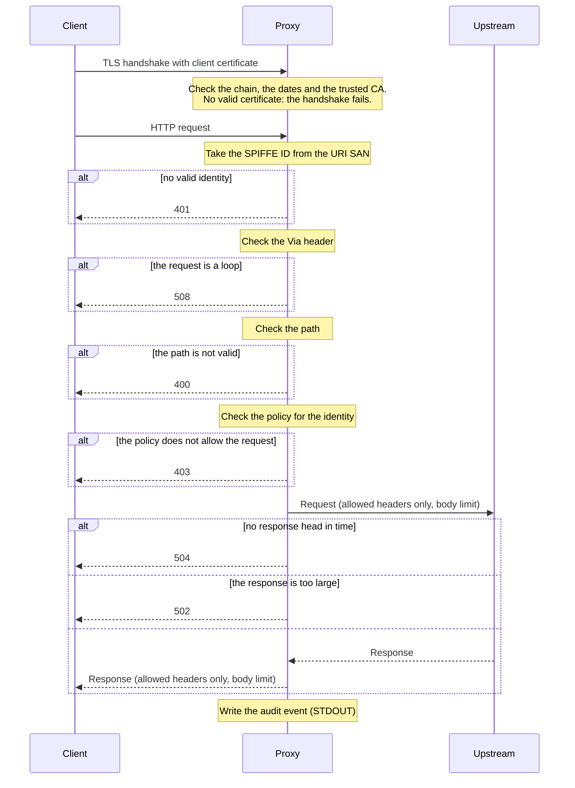

# reverse-proxy

A reverse proxy, and a small web server to test it with.

## Overview

The proxy sits in front of one upstream and lets only known clients reach it. One binary has two modes: `proxy` and `server` (the test upstream).

- **Identity.** Clients use mutual TLS. The identity is the SPIFFE ID in the URI SAN of the client certificate. A request with no valid identity gets `401`.
- **Policy.** A YAML file lists the methods and paths that each identity may use. The default is deny (`403`). The proxy rejects unsafe paths with `400`.
- **Headers.** The proxy forwards only the request headers on an allowlist. It sets `Host`, `X-Forwarded-*` and the trace headers itself. It stops loops with `Via` (`508`).
- **Limits.** The proxy has timeouts and body size limits. It streams both bodies and does not keep them in memory.
- **Audit.** The proxy writes one JSON event for each request to STDOUT. Other logs go to STDERR.
- **Telemetry.** The proxy sends OpenTelemetry spans and a timeout counter, if you set an endpoint.
- **Operation.** It reloads the client CA bundle while it runs, and it stops gracefully on SIGINT and SIGTERM. A container image is available.
- **Benchmarks.** Two benchmarks measure the latency that the proxy adds. See [`docs/benchmarks.md`](docs/benchmarks.md).

To try it, see "Test it end to end". For the checks that the proxy makes, see "Call Flow".

## Call Flow

The proxy checks each request in this order. The first check that fails gives the answer. Both bodies stream. The proxy does not keep them in memory.



## TLS and identity

The proxy checks the client certificate in two places. The TLS layer (`rustls`, in the handshake) decides if the certificate is trusted. The application (`src/identity.rs`, after the handshake) decides who the client is.

**TLS layer (`rustls`).** The proxy requires a client certificate. It uses `WebPkiClientVerifier` with the CAs in `PROXY_CLIENT_CA`. The handshake fails, and the client never sends an HTTP request, if:

- the client sends no certificate;
- the chain does not end in a CA of the bundle (an untrusted chain), or the certificate has a signature that is not valid;
- the certificate is expired, or not valid yet (NotBefore and NotAfter);
- the certificate cannot be used for a client.

The proxy does not check if a certificate is revoked (no CRL and no OCSP). To stop a client, remove its CA from the bundle (see "Configuration"), or remove the identity from the policy.

**Application.** After the handshake, the proxy reads the certificate of the client, once for each connection. The identity is the SPIFFE ID in the URI SAN. The certificate must have exactly one URI SAN, and it must be a valid SPIFFE ID: the `spiffe://` scheme, a trust domain, a path, and no user info, port, query or fragment. If not, every request on that connection gets `401`. The handshake has already worked, so the proxy can write an audit event for it.

| Case                                  | Where it fails | Result          |
| ------------------------------------- | -------------- | --------------- |
| No client certificate                 | TLS layer      | handshake fails |
| Untrusted chain or CA                 | TLS layer      | handshake fails |
| Expired or not valid yet              | TLS layer      | handshake fails |
| No URI SAN                            | Application    | `401`           |
| More than one URI SAN                 | Application    | `401`           |
| URI SAN is not a valid SPIFFE ID      | Application    | `401`           |
| Valid identity that the policy denies | Application    | `403`           |

`rustls` checks the chain, the signatures and the dates. Nothing checks the serial number, the subject, the issuer or the DNS SANs. The proxy uses the SPIFFE ID only, and does not compare the trust domain to a list. The policy file decides which identities are allowed.

The proxy writes the other fields of the client certificate to the audit event (see "Audit events"): `cert_subject`, `cert_issuer`, `cert_serial` (hex), `cert_not_before`, `cert_not_after`, `cert_uri_sans` and `cert_dns_sans`. The proxy does not use them for a decision, and never writes the certificate itself. They can have names of people or systems, so give the audit log the same access control as the data that the proxy protects.

The proxy reads the fields after the handshake works. A certificate that the TLS layer rejects (expired, not valid yet, untrusted) has no HTTP request and no audit event, so its fields are not recorded. See `docs/adrs/006-log-client-certificate-fields.md`.

A certificate is checked in the handshake only. A connection that is open keeps working after its certificate expires, or after the CA is removed from the bundle. See `docs/adrs/003-reload-the-client-ca-bundle.md`.

## Architectural Decisions

The ADRs in `docs/adrs/` give the reason for each decision.

- [ADR 001](docs/adrs/001-no-percent-decoding-in-path-policy.md): the policy checks the path as the client sent it, and does not decode `%` sequences.
- [ADR 002](docs/adrs/002-headers-the-proxy-forwards.md): the proxy forwards only the headers on an allowlist, and it handles `Forwarded` and `X-Forwarded-*` on purpose.
- [ADR 003](docs/adrs/003-reload-the-client-ca-bundle.md): the proxy reloads the client CA bundle while it runs, and keeps the old CAs if the new file is not valid.
- [ADR 004](docs/adrs/004-timeouts-and-telemetry.md): the proxy has timeouts for the client and the upstream, and it exports OpenTelemetry spans and metrics.
- [ADR 005](docs/adrs/005-body-size-limits-and-streaming.md): the proxy limits the request and response bodies, and it streams them without buffering.
- [ADR 006](docs/adrs/006-log-client-certificate-fields.md): the proxy writes the fields of the client certificate to the audit event, and does not use them for a decision.
- [ADR 007](docs/adrs/007-no-retries.md): the proxy does not retry a request that it sent to the upstream, and the client gets the failure at once.

## Configuration

The program reads these environment variables once, at start. A variable that is set must not be empty.

| Variable | Default | Mode | Meaning |
| --- | --- | --- | --- |
| `PROXY_ADDR` | `127.0.0.1:8443` | `proxy` | The address (`host:port`) that the proxy listens on. |
| `SERVER_ADDR` | `127.0.0.1:9000` | both | The address of the `server` mode. The proxy sends its requests here. |
| `PROXY_TLS_CERT` | none (required) | `proxy` | The path of the certificate file (PEM). |
| `PROXY_TLS_KEY` | none (required) | `proxy` | The path of the private key file (PEM). |
| `PROXY_CLIENT_CA` | none (required) | `proxy` | The path of the CA bundle file (PEM) that signs the client certificates. The proxy reloads it when it changes. |
| `PROXY_POLICY_FILE` | none (required) | `proxy` | The path of the policy file (YAML). See `policies.yaml`. |
| `PROXY_CLIENT_TIMEOUT_SECS` | `10` | `proxy` | How long the client has to send the request head, and then the request body, in seconds (a whole number, more than 0). After that, the client gets `408` (or the connection closes). |
| `PROXY_UPSTREAM_TIMEOUT_SECS` | `10` | `proxy` | How long the proxy waits for the response head from the upstream, in seconds (a whole number, more than 0). After that, the client gets `504`. |
| `PROXY_MAX_REQUEST_BODY_BYTES` | `1048576` (1 MiB) | `proxy` | The largest request body, in bytes (a whole number). `0` means no limit. A larger body gets `413`. |
| `PROXY_MAX_RESPONSE_BODY_BYTES` | `1048576` (1 MiB) | `proxy` | The largest response body, in bytes (a whole number). `0` means no limit. See "Body size and streaming". |
| `OTEL_EXPORTER_OTLP_ENDPOINT` | none | `proxy` | The OTLP/HTTP endpoint for spans and metrics (for example `http://localhost:4318`). The proxy does not export if it is not set. `OTEL_EXPORTER_OTLP_TRACES_ENDPOINT` and `OTEL_EXPORTER_OTLP_METRICS_ENDPOINT` set one signal only. |
| `OTEL_SERVICE_NAME` | `reverse-proxy` | `proxy` | The service name in the spans and metrics. |
| `RUST_LOG` | `info` | both | The log level of the logs on STDERR, for example `debug`. It does not change the audit events. |

The `proxy` mode stops at start, with exit code 1, if `PROXY_TLS_CERT`, `PROXY_TLS_KEY`, `PROXY_CLIENT_CA` or `PROXY_POLICY_FILE` is not set, if a file cannot be read or is not valid, if `PROXY_CLIENT_TIMEOUT_SECS` or `PROXY_UPSTREAM_TIMEOUT_SECS` is not a whole number of seconds, more than 0, if `PROXY_MAX_REQUEST_BODY_BYTES` or `PROXY_MAX_RESPONSE_BODY_BYTES` is not a whole number of bytes, or if `SERVER_ADDR` is the same text as `PROXY_ADDR`. The `server` mode does not use the TLS variables.

The `proxy` mode requires a client certificate (mTLS). A client without a certificate that the CA in `PROXY_CLIENT_CA` signed fails the TLS handshake.

The proxy watches the `PROXY_CLIENT_CA` file. When the file changes, it loads the new CAs without a restart. New connections use them. Connections that are open, and the requests that are running, do not change. If the new file is not valid, the proxy writes a warning to STDERR and keeps the old CAs. The proxy does not resume TLS sessions. See `docs/adrs/003-reload-the-client-ca-bundle.md`.

## Shutdown

Both modes stop gracefully on Ctrl+C (SIGINT) and on SIGTERM. Container platforms send SIGTERM to stop a container. The program stops to accept new connections, lets the requests that are running finish, and exits with code 0.

## Policy

The `proxy` mode checks every request against the policy file (`PROXY_POLICY_FILE`, see `policies.yaml`). The file lists, for each client identity (SPIFFE ID), the methods and paths that it may use. A path is exact (`/payments`) or a prefix (`/reports/*`). A prefix matches whole segments, and needs at least one more segment. The proxy ignores the query.

The proxy checks the policy file when it starts, and stops at the first problem (exit code 1):

1. The file must follow the schema in `policy-schema.yaml`. It is a [YAML schema](https://yaml-schema.net/) that the program has built in. The schema checks the fields (no unknown field, `allow` is not empty), that the `identity` is a `spiffe://` URI, and that the `method` is an HTTP method. A method can have any letter case (`GET` or `get`).
2. The values must be valid. An `identity` must be a valid SPIFFE ID. In a `path`, a `*` is only allowed as the last segment, as `/*`. A path that no request can match, for example `/a/../b`, is an error.

The proxy answers with an empty body, and does not send the request to the upstream, in these cases:

| Status | Case |
| --- | --- |
| `401` | The client certificate has no valid identity. |
| `400` | The path is not valid: `..`, `.`, `//`, `%2f`, `%2e`, `%5c`, `%00`, NUL. |
| `403` | The policy does not allow this identity to send this request. |
| `508` | The request came back to this proxy (a loop). See "Headers". |
| `408` | The client does not send the request body within `PROXY_CLIENT_TIMEOUT_SECS`. The body is empty. |
| `413` | The request body is larger than `PROXY_MAX_REQUEST_BODY_BYTES`. The body is empty. |
| `502` | The response body is larger than `PROXY_MAX_RESPONSE_BODY_BYTES`, and the upstream said so in its head (`Content-Length`). The body is `Bad Gateway`. |
| `502` | The proxy cannot connect to the upstream, or the upstream fails before it sends a response head. The body is `Bad Gateway`. |
| `504` | The upstream sends no response head within `PROXY_UPSTREAM_TIMEOUT_SECS`. The body is `Gateway Timeout`. |

Timeouts:

- **Client head (HTTP/1):** the client has `PROXY_CLIENT_TIMEOUT_SECS` to send the request head. After that, the proxy closes the connection. HTTP/2 has no such limit in the proxy.
- **Client body:** the client has `PROXY_CLIENT_TIMEOUT_SECS`, from the time that the proxy has the request head, to send the whole body. After that, the proxy stops the request to the upstream and answers `408`. The limit is for the whole body, not for each chunk.
- **Upstream:** the upstream has `PROXY_UPSTREAM_TIMEOUT_SECS`, from the time that the proxy begins to forward the request, to send the response head. The time includes the connection and the sending of the request. After that, the client gets `504`. A slow client hits its own limit first, because the limits are 10 seconds by default and the client limit starts first.
- **Not limited:** a response body that stops after its head, and the time that a connection is idle between requests.

Each timeout adds 1 to a counter. See "OpenTelemetry".

Body size and streaming:

- **Streaming:** the proxy never reads a whole body into memory. It sends each chunk of the request body to the upstream, and each chunk of the response body to the client, as it arrives. A slow reader slows the sender.
- **Request limit:** if the request has a `Content-Length` above the limit, the proxy answers `413` and does not connect to the upstream. Without a length (a chunked body), the proxy counts the bytes while it streams. When the count passes the limit, the proxy stops the request to the upstream, closes that connection, and answers `413`. The upstream can have the first part of the body.
- **Response limit:** if the response head has a `Content-Length` above the limit, the proxy sends nothing of the body and answers `502`. Without a length, the proxy counts the bytes while it streams. When the count passes the limit, the proxy closes the upstream connection and the response to the client stops before its end. The client already has the status and the headers, so the status cannot change, and the audit event has the status of the head.
- **What the count includes:** the bytes of the body as the proxy sees them, without the headers and without the trailers. The proxy does not decode compressed bodies.
- **`GET` body:** `hyper` does not send the body of a `GET` request to the upstream, so the limit does not apply to it.
- **Race:** if the upstream sends its response before it reads the whole request body, the client gets that response and not `413`.
- A limit of `0` turns the limit off for that direction.

The proxy does not decode `%` sequences in the path. See `docs/adrs/001-no-percent-decoding-in-path-policy.md`.

## Headers

The proxy sends only some request headers to the upstream: `Accept`, `Accept-Encoding`, `Accept-Language`, `Cache-Control`, `Content-Encoding`, `Content-Length`, `Content-Type`, `If-Match`, `If-Modified-Since`, `If-None-Match`, `If-Unmodified-Since`, `Range`, `User-Agent`, `Via` and `X-Request-Id`. It removes all other request headers, for example `Authorization`, `Cookie` and custom headers. It sets `Host`, `X-Forwarded-For`, `X-Forwarded-Proto` and `X-Forwarded-Host` itself, and ignores the values that the client sent for them. It also sets `traceparent` and `tracestate` (see "OpenTelemetry"), and does not forward `baggage`. It keeps `Via` and adds its own name (`reverse-proxy-` and 8 random digits, new at each start). If a request already has this name in `Via`, it came back to the proxy: the proxy answers `508` and does not forward it. For a response, it removes the hop-by-hop headers (`Connection`, `Transfer-Encoding` and others) and forwards the rest. The list is `ALLOWED_REQUEST` in `src/headers.rs`. See `docs/adrs/002-headers-the-proxy-forwards.md`.

## OpenTelemetry

The proxy makes one span for each request that it sends to the upstream. The span is `upstream request` (kind `client`). It has the attributes `http.request.method`, `server.address`, `server.port`, `http.response.status_code` and, for a failure, `error.type` (`timeout`, `client_timeout`, `connection` or a `5xx` status). It never has the query, a header or the identity of the client. The span ends when the response head arrives, or when the request fails.

The proxy keeps the trace of the client. If the request has a valid W3C `traceparent`, the span is a child of it, with the same trace ID. If not, the proxy starts a new trace. The upstream gets `traceparent` (with the ID of the span of the proxy) and `tracestate`. The proxy ignores any other value.

The counter `reverse_proxy.timeouts` adds 1 for each timeout. Its attribute `timeout.kind` is `upstream`, `client_body`, `client_header` (HTTP/1) or `handshake` (the TLS handshake).

The proxy sends spans and metrics (OTLP over HTTP) only if you set `OTEL_EXPORTER_OTLP_ENDPOINT`. Without it, the proxy still makes trace IDs and counts, and exports nothing. See `docs/adrs/004-timeouts-and-telemetry.md`.

## Audit events

The `proxy` mode writes one audit event for each request that it decides on, as one line of JSON on STDOUT. The other logs go to STDERR. `RUST_LOG` does not change the audit events.

```json
{
  "timestamp": "2026-11-18T10:00:00.123456Z",
  "level": "INFO",
  "request_id": "9c82...",
  "identity": "spiffe://acme/prod/reporting-agent",
  "method": "GET",
  "path": "/reports/1",
  "host": "localhost:8443",
  "decision": "ALLOW",
  "status": 200,
  "upstream_status": 200,
  "latency_ms": 14,
  "target": "audit"
}
```

| Field | Meaning |
| --- | --- |
| `timestamp` | The time of the event (RFC 3339, UTC). Added by `tracing-subscriber`. |
| `request_id` | The `X-Request-Id` of the request (the client's, or a new one). |
| `identity` | The SPIFFE ID of the client. Not present if there is none. |
| `cert_subject`, `cert_issuer` | The subject and the issuer of the client certificate. Not present if the client has no certificate that the proxy can read. |
| `cert_serial` | The serial number of the client certificate, in hexadecimal, with `:` between bytes. |
| `cert_not_before`, `cert_not_after` | The validity of the client certificate (RFC 2822). |
| `cert_uri_sans`, `cert_dns_sans` | All URI SANs and all DNS SANs, separated by `,`. Not present if there are none. |
| `method`, `path` | The method and the path. The query is never in the event. |
| `host` | The `Host` header, as the client sent it. Not present if none. |
| `decision` | `ALLOW` (sent to the upstream) or `DENY`. |
| `reason` | Only for `DENY`: `no_identity`, `invalid_path`, `policy` or `loop`. |
| `status` | The status that the client got. |
| `upstream_status` | The status from the upstream. Not present if the proxy did not get a response from it (a `DENY`, or a `502`). |
| `trace_id` | The trace ID (32 hexadecimal digits). The ID of the client trace if the client sent a valid `traceparent`. Not present if the request has no trace (for example a `401`). |
| `latency_ms` | The time from the request to the response head, in milliseconds. |

An event never has a header, a cookie, a body or a query. It never has the certificate itself.

## Container image

The image has both modes. The default command is `proxy`. The command `server` runs the test upstream. The image has no certificate, key, CA or policy. Mount them when you run the container.

Build the image:

```sh
docker build -t reverse-proxy .
```

Run it. `SERVER_ADDR` is the upstream (`host:port`, plain HTTP). It has no default in the image. The proxy listens on `0.0.0.0:8443` in the container.

```sh
docker run --rm -p 8443:8443 \
  -e SERVER_ADDR=backend.internal:8080 \
  -v "$PWD/tls:/etc/reverse-proxy/tls:ro" \
  -v "$PWD/trust:/etc/reverse-proxy/trust:ro" \
  -v "$PWD/policies.yaml:/etc/reverse-proxy/policies.yaml:ro" \
  reverse-proxy
```

These are the files and the variables that find them:

| File | Path in the container | Variable |
| --- | --- | --- |
| Server certificate | `/etc/reverse-proxy/tls/server.pem` | `PROXY_TLS_CERT` |
| Server key | `/etc/reverse-proxy/tls/server.key` | `PROXY_TLS_KEY` |
| Client CA bundle | `/etc/reverse-proxy/trust/ca.pem` | `PROXY_CLIENT_CA` |
| Policy | `/etc/reverse-proxy/policies.yaml` | `PROXY_POLICY_FILE` |

Mount the directory of the CA bundle, not only the file. The proxy reloads the CA when the file changes. A mount of one file can keep the old content when a tool replaces the file.

### Test with the dev files

This starts the `server` mode as the upstream, and the proxy in front of it. The proxy uses the dev certificates and `policies.yaml` from this repository. The image runs as a user that is not root, so `--user` lets it read the dev keys (mode `600`).

```sh
./scripts/gen-dev-certs.sh
docker network create proxy-test

docker run -d --name backend --network proxy-test \
  -e SERVER_ADDR=0.0.0.0:9000 \
  reverse-proxy server

docker run -d --name proxy --network proxy-test \
  --user "$(id -u):$(id -g)" -p 8443:8443 \
  -e SERVER_ADDR=backend:9000 \
  -e PROXY_TLS_CERT=/etc/reverse-proxy/dev/server.pem \
  -e PROXY_TLS_KEY=/etc/reverse-proxy/dev/server.key \
  -e PROXY_CLIENT_CA=/etc/reverse-proxy/dev/ca.pem \
  -v "$PWD/dev-certs:/etc/reverse-proxy/dev:ro" \
  -v "$PWD/policies.yaml:/etc/reverse-proxy/policies.yaml:ro" \
  reverse-proxy

curl --cacert dev-certs/ca.pem \
  --cert dev-certs/payment-agent.pem --key dev-certs/payment-agent.key \
  -X POST https://localhost:8443/payments
```

The answer is `200`. A `GET /payments` gives `403`, and a request without `--cert` fails the TLS handshake. `docker logs proxy` shows the audit events. To clean up:

```sh
docker stop proxy backend && docker rm proxy backend
docker network rm proxy-test
```

## Test it end to end

Make the test certificates (see "Local TLS setup"), then start the `server` and the `proxy` in two terminals. The proxy needs the TLS variables and `PROXY_POLICY_FILE=policies.yaml`:

```sh
cargo run -- server
cargo run -- proxy
```

In a third terminal, run:

```sh
scripts/send-test-requests.rb
```

The script is in Ruby (3.x). It uses only the standard library. It checks that the `server` and the `proxy` are running. Then it sends requests with each test certificate and prints the status of each answer. It exits with code 1 if a status is not the expected one. It expects the rules of `policies.yaml` in this repository. The requests cover:

- requests that the policy allows (`200`);
- requests that it denies (`403`);
- paths that are not valid (`400`);
- a certificate with no identity (`401`);
- clients that fail the TLS handshake: no certificate, an untrusted CA, an expired certificate.

The audit events are in the terminal of the `proxy` (STDOUT), one line for each request that passed the handshake. A request with a query, such as `/reports/1?token=...`, must have only `/reports/1` in the `path` field.

To send one request by hand:

```sh
curl --cacert dev-certs/ca.pem \
  --cert dev-certs/payment-agent.pem --key dev-certs/payment-agent.key \
  -X POST https://127.0.0.1:8443/payments
```

## Local TLS setup

Make a CA and a server certificate for local tests:

```sh
./scripts/gen-dev-certs.sh
```

The script uses `openssl`. It writes these files to `dev-certs/`:

- `ca.pem` and `ca.key`: a self-signed CA (EC P-256).
- `server.pem` and `server.key`: a server certificate (EC P-256), signed by the CA. It is valid for `localhost` and `127.0.0.1`.
- `payment-agent.pem` and `payment-agent.key`: a client certificate (EC P-256), signed by the CA. Its URI SAN is `spiffe://acme/prod/payment-agent`.
- `reporting-agent.pem` and `reporting-agent.key`: a client certificate (EC P-256), signed by the CA. Its URI SAN is `spiffe://acme/prod/reporting-agent`.

The script also makes files for tests that must fail. The proxy must reject these clients:

- `other-ca.pem` and `other-ca.key`: a second CA. The proxy does not trust it.
- `untrusted-agent.pem` and `untrusted-agent.key`: a client certificate that the second CA signed.
- `expired-agent.pem` and `expired-agent.key`: a client certificate that the CA signed. It expired in January 2020. The `check` command does not report it.
- `no-uri-agent.pem` and `no-uri-agent.key`: a client certificate that the CA signed. It has no URI SAN, so it has no SPIFFE ID. The handshake works, but the proxy answers every request with `401`.

The certificates are valid for 30 days. The script is safe to run many times. It makes only the files that are missing or expired.

To check the files without a change, run:

```sh
./scripts/gen-dev-certs.sh check
```

The command exits with code 1 if a file is missing or a certificate is expired.

To check the certificate by hand:

```sh
openssl verify -CAfile dev-certs/ca.pem dev-certs/server.pem
openssl x509 -in dev-certs/server.pem -noout -text | grep -A1 "Alternative Name"
```

> **Warning:** Use these certificates for local development and tests only. Never trust the CA outside your own machine. Never commit a key. Git ignores `dev-certs/`.

## Benchmarks

There are two benchmarks in `benches/`. Both send `POST /echo` with a random body (letters and digits, 32 to 1024 bytes) over a connection that stays open. Each one measures the upstream alone, and the proxy in front of it. The difference is what the proxy adds. `benches/common.rs` has the code that they share.

By default, a benchmark starts the `server` mode and the `proxy` mode itself, each on a free port. It uses the dev certificates (it makes them if they are missing or expired), and the policy of the tests. The programs write no audit events to the terminal, and the log level is `warn`. To use a stack that is already running, give both addresses (`host:port`).

**Custom benchmark (percentiles).** It runs a warm-up and then a measurement for each number of callers. It reports the requests, the error rate, the requests per second, and the latency (min, p50, p90, p95, p99 and max). Then it reports what the proxy adds.

```sh
cargo bench --bench custom_benchmark
cargo bench --bench custom_benchmark -- -C 1,10,100 --warmup-secs 5 --duration-secs 30 --seed 42
```

| Option | Default | Meaning |
| --- | --- | --- |
| `--warmup-secs` | `5` | The seconds of warm-up before each measurement. The results of the warm-up are dropped. |
| `--duration-secs` | `30` | The seconds of each measurement. |
| `-C`, `--concurrency` | `1` | The numbers of callers (1 to 1000), separated by commas. Each caller has its own connection. |
| `--seed` | none | The seed for the random bodies. Caller `i` uses the seed plus `i`. |
| `--proxy-addr`, `--upstream-addr` | none | The addresses of a stack that is already running. Give both, or neither. |

For hundreds of callers, raise the limit of open files first, for example `ulimit -n 4096`.

**Criterion benchmark (regressions).** It sends one request at a time, and finds a change in the speed. Save a baseline, change the code, and compare:

```sh
cargo bench --bench criterion_benchmark -- --save-baseline before
cargo bench --bench criterion_benchmark -- --baseline before
```

Criterion writes an HTML report to `target/criterion`. To use a stack that is already running, set `BENCH_PROXY_ADDR` and `BENCH_UPSTREAM_ADDR`.

The results of a run, with charts, are in [`docs/benchmarks.md`](docs/benchmarks.md).

**See where the time goes.** The proxy has spans for the steps of a request. They go to OpenTelemetry only, and only if `OTEL_EXPORTER_OTLP_ENDPOINT` is set. Without it, the proxy makes no spans. `docker-compose.yml` starts `grafana/otel-lgtm`, which collects the spans and the metrics:

```sh
docker compose up -d
OTEL_EXPORTER_OTLP_ENDPOINT=http://localhost:4318 cargo bench --bench custom_benchmark
```

Open Grafana at http://localhost:3000 (user `admin`, password `admin`). In Explore, choose the data source Tempo and run `{ resource.service.name = "reverse-proxy" }`. A benchmark that starts its own stack passes the variable to the proxy only. The upstream does not export.

| Span | What it covers |
| --- | --- |
| `request` | One request in the proxy. It is the root, or a child of the span of the client. |
| `header_filtering` | The change of the request headers and the URI. |
| `policy_check` | The check of the policy. |
| `upstream request` | The request to the upstream, to the response head. |
| `audit_write` | The write of the audit event to STDOUT. |
| `tls_handshake` | The TLS handshake of one connection. It has its own trace. |
| `identity_extraction` | The read of the client certificate, once for each connection. It has its own trace. |

## Security considerations

- **Default deny.** The policy lists what each identity may do. An identity that is not in the file gets `403`. A request without a valid identity gets `401` before any other check.
- **Path.** The policy checks the path as the client sent it. The proxy does not decode `%` sequences and does not normalize the path. It rejects `..`, `.`, `//`, `%2f`, `%2e`, `%5c` and `%00` with `400`. See `docs/adrs/001-no-percent-decoding-in-path-policy.md`.
- **Headers.** The proxy forwards only the request headers on an allowlist. `Authorization`, `Cookie` and custom headers do not reach the upstream. The proxy sets `Host` and `X-Forwarded-*` itself, and ignores the values from the client. See `docs/adrs/002-headers-the-proxy-forwards.md`.
- **Loops.** The proxy adds its name to `Via`. A request that already has it gets `508`.
- **Limits.** The proxy has timeouts for the TLS handshake, the request head, the request body and the response head, and a size limit for each body. They protect the proxy from slow clients and large bodies. See "Policy".
- **Audit events.** An event never has a header, a cookie, a body, a query or the certificate. It has names from the certificate, so give the audit log the same access control as the data that the proxy protects.
- **Keys.** Mount the private key with the mode `600` or `400`. The container runs as a user that is not root. Never put a key in the image or in git.
- **Image.** The runtime image is distroless. It has no shell and no package manager.

## Assumptions

- The network between the proxy and the upstream is trusted. The proxy sends its requests to the upstream in plain HTTP, over HTTP/1.1. The upstream does not check who the client is. It trusts the proxy.
- Only the proxy can reach the upstream. If a client can reach the upstream directly, it skips the policy.
- There is one upstream. `SERVER_ADDR` is a fixed `host:port`.
- A client has a SPIFFE ID in the URI SAN of its certificate. A certificate with none is a client with no identity.
- The CA that signs the client certificates is the only trust anchor. The policy file decides which identities of that CA may do what. The proxy does not compare the trust domain to a list.
- A platform (for example a container platform) starts the proxy again if it stops, sends SIGTERM to stop it, and collects STDOUT (the audit events) and STDERR (the logs).
- The operator can change the policy and the server certificate with a restart.

## Known limitations

- **No revocation.** The proxy does not use a CRL or OCSP. To stop a client, remove its CA from the bundle, or remove its identity from the policy.
- **Certificates are checked in the handshake only.** A connection that is open keeps working after its certificate expires, or after the CA is removed from the bundle. See `docs/adrs/003-reload-the-client-ca-bundle.md`.
- **Rejected certificates have no audit event.** A client that fails the TLS handshake sends no HTTP request. The proxy writes a `debug` line only. See `docs/adrs/006-log-client-certificate-fields.md`.
- **Reload.** The proxy reloads the client CA bundle, but not the policy file, the server certificate or the server key. Restart the proxy to change them.
- **No retries.** One client request makes at most one request to the upstream. See `docs/adrs/007-no-retries.md`.
- **No TLS to the upstream.** The proxy does not encrypt the connection to the upstream, and it does not use a client certificate with it.
- **One upstream.** The proxy has no load balancing, no health checks and no circuit breaker.
- **No rate limit.** The proxy has no limit for the number of requests or connections for each client.
- **The audit event is at the response head.** The proxy writes it when the response head is ready. If a response body fails or is cut later (for example by the size limit), the event still has the status of the head.
- **Some times are not limited.** There is no limit for a response body that stops after its head, for the time that a connection is idle, or for the request head of an HTTP/2 client.
- **A `GET` body.** `hyper` does not send the body of a `GET` request to the upstream.
- **Metrics.** The proxy has one counter, for timeouts. It has no counter of requests, statuses or latency.
- **No health endpoint.** An orchestrator can only test the TLS port.

## Production considerations

- **Certificates.** Use a real CA for the server certificate and for the clients. The files in `dev-certs/` are for local tests only. Plan the renewal of the server certificate: the proxy needs a restart to use a new one.
- **Trust store.** The proxy reloads the CA bundle when the file changes. In a fleet, send the new bundle to all the instances. Mount the directory, not one file (see "Container image"), and add a new CA before you remove the old one. Instances that did not get the new bundle yet still trust the old CAs, and connections that are open do not change.
- **Revocation.** Because the proxy has no CRL or OCSP, use short-lived client certificates. Then a stolen key stops working soon.
- **Network.** Put the proxy and the upstream in a private network. Allow only the proxy to reach the upstream. Open the proxy port only to the clients. If the network to the upstream is not trusted, add TLS with a sidecar or a service mesh, because the proxy does not do it.
- **Policy changes.** A new policy needs a restart. Use a rolling restart, so that the service stays up. SIGTERM lets the requests that run finish. The proxy waits 10 seconds at most for open connections, so set the grace period of the platform to more than 10 seconds.
- **Logs.** Collect STDOUT as the audit log, and keep it apart from STDERR. Set the retention and the access control for it. Set `RUST_LOG` to `info` or lower: `debug` writes a line for each failed handshake.
- **Telemetry.** Set `OTEL_EXPORTER_OTLP_ENDPOINT` to send spans and the timeout counter to a collector. Alert on the timeout counter and on `502`, `504` and `403` in the audit events.
- **Limits.** Set the timeouts and the body limits for your upstream. The defaults are 10 seconds and 1 MiB. A larger limit uses more time and bandwidth for each request, and the proxy does not limit the number of requests.
- **Scale.** The proxy keeps no state between requests, so you can run many instances behind a TCP load balancer. Use a load balancer that does not end TLS, because the proxy needs the client certificate. Set a limit for the connections at the load balancer, because the proxy has none.
- **Retries and idempotency.** The client must retry a failed request only if the request is safe to send again (see ADR 007).
