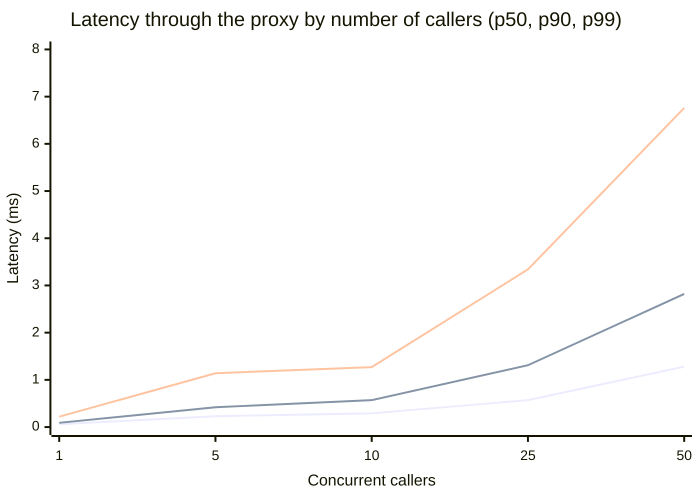
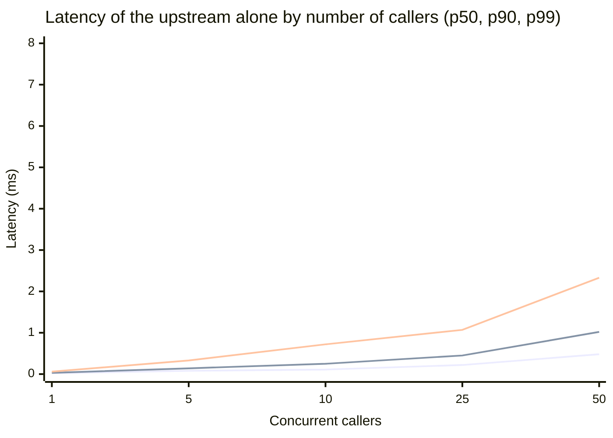
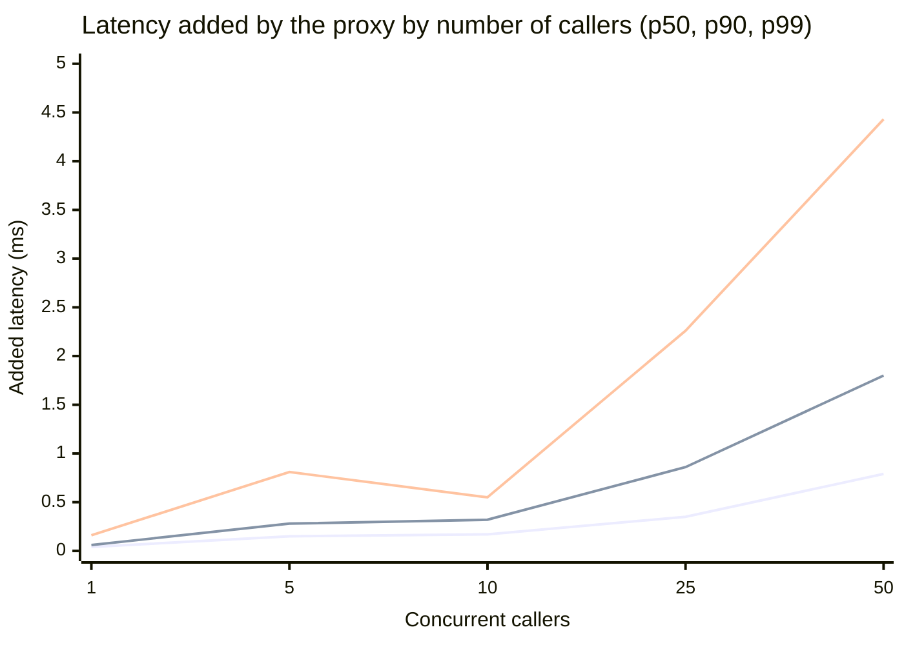
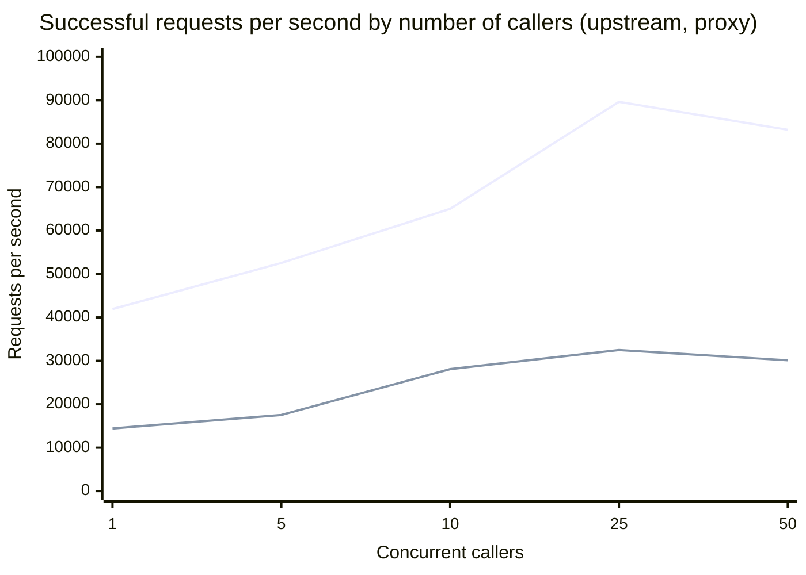

# Benchmarks

This page has the results of `benches/custom_benchmark.rs`. It sends `POST /echo` with a random body (letters and digits, 32 to 1024 bytes). It measures the upstream alone (plain HTTP), and the proxy in front of it (mTLS). Each caller has one connection that stays open.

To run the benchmarks again, see "Benchmarks" in the [README](../README.md).

## Summary

- The proxy has no errors at any level. The error rate is 0.00% in every run.
- At 1 caller, the proxy adds about 0.04 ms at p50 and 0.16 ms at p99.
- The added latency grows with the number of callers. At 50 callers, it adds 0.79 ms at p50 and 4.43 ms at p99.
- The proxy handles 33% to 43% of the requests per second of the upstream. The proxy does TLS, header filtering, a policy check and an audit write for each request. The test server does almost no work.

## Setup

| Item | Value |
| --- | --- |
| Machine | Apple M5, 10 cores, macOS 27.2.1 |
| Rust | rustc 1.99.1, `cargo bench` (optimized) |
| Commit | `41c4782` plus the uncommitted changes that add the benchmarks and the spans |
| Command | `cargo bench --bench custom_benchmark -- -C 1,5,10,25,50 --warmup-secs 5 --duration-secs 30 --seed 42` (with `ulimit -n 4096`) |
| Warm-up | 5 s, then 30 s of measurement, for each target and each number of callers |
| Proxy config | The defaults. No OpenTelemetry export, so the proxy makes no spans. The audit events go to STDOUT, and the benchmark drops them. |
| Protocol | Client to proxy: TLS 1.3 with a client certificate, HTTP/1.1. Proxy to upstream: HTTP/1.1, plain. |

## Results

Latency is in milliseconds. "Added" is the proxy minus the upstream, at the same percentile. The throughput is the number of successful requests each second.

| Callers | Target | Requests/s | p50 | p90 | p99 | Added p50 | Added p90 | Added p99 |
| --: | --- | --: | --: | --: | --: | --: | --: | --: |
| 1 | upstream | 41,924 | 0.02 | 0.03 | 0.06 |  |  |  |
| 1 | proxy | 14,426 | 0.06 | 0.09 | 0.22 | +0.04 | +0.06 | +0.16 |
| 5 | upstream | 52,542 | 0.08 | 0.14 | 0.33 |  |  |  |
| 5 | proxy | 17,532 | 0.23 | 0.42 | 1.14 | +0.15 | +0.28 | +0.81 |
| 10 | upstream | 64,994 | 0.11 | 0.25 | 0.72 |  |  |  |
| 10 | proxy | 28,086 | 0.29 | 0.57 | 1.27 | +0.17 | +0.32 | +0.55 |
| 25 | upstream | 89,644 | 0.22 | 0.45 | 1.07 |  |  |  |
| 25 | proxy | 32,499 | 0.57 | 1.31 | 3.34 | +0.35 | +0.86 | +2.26 |
| 50 | upstream | 83,221 | 0.48 | 1.02 | 2.33 |  |  |  |
| 50 | proxy | 30,124 | 1.28 | 2.82 | 6.76 | +0.79 | +1.80 | +4.43 |

## Charts

The charts have no legend. The lines are in the order of the title.

### Latency through the proxy

Lines: p50, p90, p99.

### Latency of the upstream alone

Lines: p50, p90, p99. The scale is the same as the chart above.

### Latency that the proxy adds

Lines: p50, p90, p99.

### Throughput

Lines: upstream, proxy.

## Limits of these results

- **The benchmark and both servers share one machine.** The load generator, the proxy and the upstream compete for 10 cores. The numbers show the relative cost of the proxy. They are not the limits of the proxy on its own hardware. Above 25 callers, the throughput stops growing for both targets, which suggests that the machine is the limit.
- **The upstream does almost no work.** `/echo` sends the body back. A real upstream is slower, so the added latency of the proxy is a smaller share of the total, and the throughput ratio is better than the 33% to 43% here.
- **The loopback network has no delay.** A real network adds a round trip, and a new TLS connection adds a handshake. Every caller here keeps one connection, so the results do not include the handshake. The proxy does a full handshake for each new connection (it does not resume sessions).
- **The audit events go nowhere.** The benchmark sends the STDOUT of the proxy to `/dev/null`. A real deployment writes them to a pipe or a file, which can cost more.
- **The p99 and the maximum have noise.** The maximum of the proxy at 25 and 50 callers (98 ms and 158 ms) is a single slow request in more than 900,000. It comes from the machine and not from the proxy. Run the benchmark again to check a result.
- **One run.** These numbers come from one run for each level. They are not an average of many runs.
- **Only `POST /echo`.** Larger bodies, HTTP/2 clients, and a new connection for each request were not measured.

## Where the time goes

This run did not measure the sources of the overhead. The proxy makes a span for each step of a request (see "Benchmarks" in the README). To see their durations, start `docker compose up -d`, run the benchmark with `OTEL_EXPORTER_OTLP_ENDPOINT=http://localhost:4318`, and look at the traces in Grafana. Add the result to this page.
